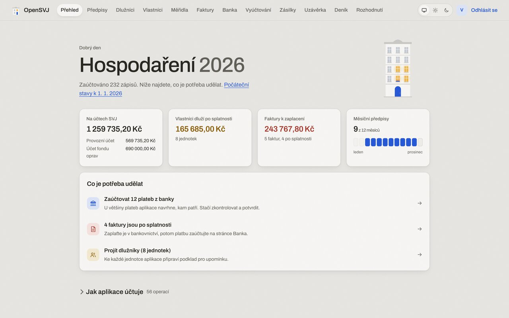

# OpenSVJ

Účetnictví domu, ve kterém se dá vyznat. OpenSVJ je open source webová aplikace pro výbor a účetní
společenství vlastníků jednotek (SVJ): z bankovních výpisů a faktur vede podvojné
účetnictví, počítá předpisy záloh, hlídá dlužníky, vyúčtovává služby i správu domu
a připravuje roční uzávěrku. Je zdarma a provozujete ji na vlastním serveru.

[Web projektu](https://jonasjancarik.github.io/opensvj/) ·
[Návod](docs/navod.md) ·
[Příručka účetnictví SVJ](docs/prirucka/README.md) ·
[Specifikace](docs/spec/README.md)



Aplikace je ve vývoji a zkouší se na účetnictví jednoho skutečného domu. Postupy, které
ještě musí potvrdit účetní, jsou v ní tak označené: zaúčtovat je jde a kontrolní seznam
uzávěrky je připomene k posouzení.

## Co umí

**Běžný měsíc**

- Nahraje výpis z banky ve formátu GPC (ABO) nebo přehled pohybů z Raiffeisenbank (CSV),
  u každé platby navrhne zaúčtování a po potvrzení ji zaúčtuje.
- Spočítá a zaúčtuje měsíční předpis záloh pro všechny jednotky.
- Eviduje přijaté faktury, zaúčtuje je podle druhu nákladu a spáruje s platbami.
- Ukáže, kolik která jednotka dluží po splatnosti, včetně zákonného úroku z prodlení.

**Dům a lidé**

- Vede vlastníky jednotek s historií převodů a při prodeji ponechá prodávajícímu dluhy,
  které na kupujícího nepřešly.
- Vede měřidla a odečty a spočítá z nich roční spotřebu jednotek.
- Vede rozhodnutí shromáždění a výboru a ukáže, o které rozhodnutí se opírá výše záloh,
  klíče rozúčtování a další volby.

**Dokumenty pro vlastníky**

- Připraví upomínku, potvrzení o dluzích pro prodej jednotky, oznámení o nové výši záloh
  a vyúčtování se jménem a adresou vlastníka.
- Rozešle je e-mailem nebo připraví k tisku, eviduje doručení a počítá od něj lhůty.

**Konec roku**

- Vyúčtuje zálohy na služby a na správu domu, přesně na haléře.
- Sestaví rozvahu a výkaz zisku a ztráty ve zkráceném rozsahu.
- Provede uzávěrkou: kontrolní seznam, inventurní soupisy, posouzení daně z příjmů
  a návrh přílohy.

Účetní logiku drží několik pevných pravidel: částky jsou celé haléře, do deníku se jen
připisuje a opravuje se stornem, vyrovnanost zápisů a uzavřená období hlídá přímo
databáze. Jak se která operace účtuje, popisuje [katalog](catalogue/README.md), kde má
každá operace zdroj v předpisech nebo literatuře a příklad ověřovaný testy.

## Vyzkoušení

Potřebujete Docker (například OrbStack), `uv` a `pnpm`.

```bash
git clone https://github.com/jonasjancarik/opensvj.git && cd opensvj
cp .env.example .env          # do AUTH_ALLOWED_EMAILS doplňte svůj e-mail
                              # a do BETTER_AUTH_SECRET výstup `openssl rand -base64 32`
docker compose up -d          # PostgreSQL na portu 5440
pnpm install
(cd backend && uv sync && uv run alembic upgrade head)
(cd backend && uv run python -m tests.naplneni)   # ukázkové SVJ s rokem dat
pnpm --dir auth migrate
```

Pak ve třech terminálech:

```bash
pnpm --dir auth dev                                                             # přihlašování, port 3010
(cd backend && uv run uvicorn svj.api:app --host 0.0.0.0 --port 8010 --reload)  # API, port 8010
pnpm --dir frontend dev                                                         # web, port 5180
```

Aplikace běží na <http://localhost:5180>. Přihlašuje se odkazem poslaným e-mailem; bez
nastavené pošty se odkaz vypíše do výstupu služby `auth`.

Ukázková data patří vymyšlenému SVJ „Ukázková 12“ s dvanácti jednotkami. Kdo chce začít
s prázdným účetnictvím, místo naplnění založí účetní roky příkazem
`uv run python -m svj.sprava otevri-obdobi 2025 2026`. Nastavení e-mailů, přístupů
a vlastního SVJ popisuje [Vývoj a provoz](docs/vyvoj.md).

## Dokumentace

| Dokument | Co v něm je |
| --- | --- |
| [Návod](docs/navod.md) | Jak se pracuje s jednotlivými stránkami aplikace, od banky po uzávěrku. |
| [Příručka účetnictví SVJ](docs/prirucka/README.md) | Proč se v SVJ účtuje tak, jak se účtuje: pravidla s odkazy na předpisy a příklady. |
| [Specifikace](docs/spec/README.md) | Co má aplikace dělat, co z toho už umí a která rozhodnutí jsou otevřená. |
| [Katalog operací](catalogue/README.md) | Jak se která operace účtuje, strojově čitelně a s příklady. |
| [Profily SVJ](profiles/README.md) | Jak se popisují jednotky, účty a předpis záloh konkrétního domu. |
| [Vývoj a provoz](docs/vyvoj.md) | Spuštění, ukázková data, e-maily, testy a stavba aplikace. |

## Z čeho se skládá

| Část | Co dělá |
| --- | --- |
| `backend/` | Python 3.13, FastAPI, SQLAlchemy a Alembic nad PostgreSQL: doména, deník, výkazy a API. |
| `auth/` | Better Auth na Node (Hono): přihlášení odkazem a krátkodobé tokeny JWT. |
| `frontend/` | React, TypeScript a Vite. |
| `catalogue/`, `profiles/` | Katalog účetních operací a profily SVJ v YAML. |
| `docs/` | Návod, příručka a specifikace. |
| `web/` | Prezentační web. |

## Co zatím chybí

Nejdůležitější mezery. Podrobný stav po oblastech je v tabulce
[Co z toho aplikace umí](docs/spec/README.md#co-z-toho-aplikace-umí).

- upozornění pro výbor (blížící se lhůty, nové faktury, dluhy) e-mailem,
- vrácené e-maily (bounce) se do zásilek zatím nezapisují samy,
- zpráva o hospodaření a evidence schválení závěrky,
- podklady a přílohy, podpisové záznamy, schvalování více lidmi a role,
- dobropisy a jiné formáty výpisů než GPC a CSV Raiffeisenbank (camt.053, MT940),
- export do Beancountu a pro programy účetních.

## Licence

OpenSVJ je svobodný software pod licencí [GNU AGPL 3.0](LICENSE). Smíte ho používat,
upravovat a šířit; kdo upravenou verzi provozuje jako službu pro jiné, musí jim zpřístupnit
i její zdrojový kód.
